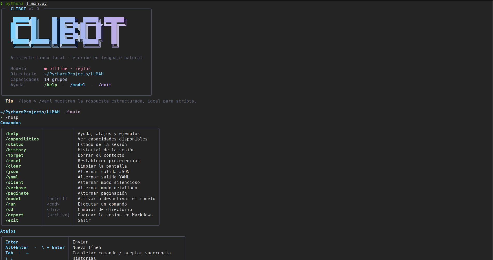

# CLIBOT (CLI Bot)

**CLIBOT** es un asistente de terminal **offline-first** para inspección, diagnóstico y administración local en sistemas Linux. 

Combina reglas locales deterministas de ejecución segura con la posibilidad de conectar modelos locales (como **Ollama**) para la interpretación de consultas avanzadas.


---

##  Requisitos Previos

- **Sistema Operativo:** Linux
- **Python:** 3.11 o superior
- **Git:** Para clonar el repositorio

---

##  Guía Paso a Paso: Descarga e Instalación

### Paso 1: Clonar / Descargar el Repositorio

Abre tu terminal y clona el repositorio en tu equipo:

```bash
git clone https://github.com/nocturne-cybersecurity/Clibot.git
cd CLIBOT
```

*(Si descargaste el archivo `.zip`, descomprímelo y accede a la carpeta extraída desde la terminal).*

---

### Paso 2: Crear el Entorno Virtual e Instalar Dependencias

Crea un entorno virtual aislado e instala los requerimientos necesarios:

```bash
# 1. Crear el entorno virtual (.venv)
python3 -m venv .venv

# 2. Activar el entorno virtual
source .venv/bin/activate

# 3. Instalar las dependencias
pip install -r requirements.txt
pip install -e .
```

---

### Paso 3: Configurar el comando global `clibot`

Para poder ejecutar el asistente desde cualquier ubicación en la terminal simplemente escribiendo `clibot` (sin necesidad de activar el entorno virtual manualmente cada vez), elige una de las siguientes opciones:

#### Opción A: Enlace Simbólico en `~/.local/bin` (Recomendado)

1. Crea la carpeta `~/.local/bin` si aún no existe:
   ```bash
   mkdir -p ~/.local/bin
   ```

2. Crea un script ejecutable llamado `clibot` en `~/.local/bin`:
   ```bash
   cat << 'EOF' > ~/.local/bin/clibot
   #!/usr/bin/env bash
   PROJECT_DIR="$(cd "$(dirname "$(readlink -f "${BASH_SOURCE[0]}")")" && pwd)"
   # Ruta absoluta al proyecto CLIBOT
   CLIBOT_PATH="/ruta/a/tu/CLIBOT"

   "${CLIBOT_PATH}/.venv/bin/python" "${CLIBOT_PATH}/llmah.py" "$@"
   EOF
   ```

3. Sustituye `/ruta/a/tu/CLIBOT` por la ruta real de tu proyecto. Puedes hacerlo automáticamente con este comando ejecutado desde la carpeta del proyecto:
   ```bash
   cat << EOF > ~/.local/bin/clibot
   #!/usr/bin/env bash
   "$(pwd)/.venv/bin/python" "$(pwd)/llmah.py" "\$@"
   EOF

   chmod +x ~/.local/bin/clibot
   ```

4. Asegúrate de que `~/.local/bin` esté en tu `$PATH`. Si no lo está, agrégalo a tu archivo de configuración (`~/.bashrc` o `~/.zshrc`):
   ```bash
   echo 'export PATH="$HOME/.local/bin:$PATH"' >> ~/.bashrc
   source ~/.bashrc
   ```

#### Opción B: Alias en la Shell (`.bashrc` / `.zshrc`)

Añade un alias directamente en la configuración de tu terminal ejecutando:

```bash
# Para Bash:
echo "alias clibot='$(pwd)/.venv/bin/python $(pwd)/llmah.py'" >> ~/.bashrc
source ~/.bashrc

# Para Zsh:
echo "alias clibot='$(pwd)/.venv/bin/python $(pwd)/llmah.py'" >> ~/.zshrc
source ~/.zshrc
```

---

##  Uso de `clibot`

Una vez configurado, puedes lanzar el asistente desde cualquier directorio:

### 1. Modo Interactivo
Simplemente escribe:
```bash
clibot
```
Esto abrirá la consola interactiva con prompt `❯` e historial de comandos.

### 2. Modo Comando Directo
Puedes pasar una consulta directa usando el parámetro `--command`:

```bash
clibot --command "muestra la memoria RAM disponible"
clibot --command "lista los archivos en ."
clibot --command "muestra el estado de la red"
clibot --command "calcula raiz cuadrada de 144"
```

---

##  Ejemplos de Uso

### Sistema
```bash
clibot --command "¿qué hora es?"
clibot --command "muestra la información del sistema"
clibot --command "¿cuánta RAM tengo disponible?"
clibot --command "¿cuál es mi usuario actual?"
```

### Archivos y Directorios
```bash
clibot --command "lista los archivos de /tmp"
clibot --command "crea archivo notas.txt"
clibot --command "crea carpeta /tmp/proyecto"
clibot --command "elimina /tmp/archivo.txt"
clibot --command "mueve a.txt a /tmp"
clibot --command "modifica /tmp/config.yaml"
clibot --command "busca texto 'error' en /var/log"
```

### Gestión de Paquetes
```bash
clibot --command "apt install vim"
clibot --command "pip install requests"
clibot --command "npm install lodash"
```

### Red
```bash
clibot --command "muestra mis interfaces de red"
clibot --command "¿cuál es mi IP pública?"
clibot --command "muestra los puertos en escucha"
```

### Git
```bash
clibot --command "muestra el estado de git"
clibot --command "ejecuta comando: git status"
```

### Comandos Multi-línea
Para comandos largos, usa `\` al final de la línea:
```bash
~/PycharmProjects/CLIBOT ❯ crea archivo script.py \
... con contenido '#!/usr/bin/env python3\nprint("Hola mundo")'
```

### Salida Estructurada
Activa modo JSON o YAML para integración con scripts:
```bash
clibot
/json
clibot --command "lista los archivos de /tmp"
/yaml
clibot --command "muestra la memoria RAM"
```

---

##  Comandos Internos de la Terminal

Dentro del modo interactivo de `clibot`, dispones de comandos útiles:
- `/help` o `/capabilities`: Muestra las capacidades y operaciones disponibles.
- `/status`: Muestra el estado del sistema y del modelo LLM configurado.
- `/history`: Muestra el historial de la sesión actual.
- `/forget`: Limpia la memoria de la sesión actual.
- `/clear`: Limpia la pantalla de la terminal.
- `/json`: Activa/desactiva la salida en formato JSON.
- `/yaml`: Activa/desactiva la salida en formato YAML (requiere PyYAML).
- `/silent`: Activa/desactiva el modo silencioso (solo errores).
- `/reset`: Restablece todas las preferencias.
- `/exit`: Sale de la aplicación.

---

##  Uso Opcional con Modelo Local (Ollama)

CLIBOT funciona 100% offline sin necesidad de un modelo externo. Sin embargo, si tienes **Ollama** instalado y ejecutándose en tu sistema, puedes activar el razonamiento con IA:

```bash
export CLIBOT_LLM_PROVIDER=ollama
export CLIBOT_LLM_MODEL='llama3.2' # Reemplaza por el nombre de tu modelo en 'ollama list'
clibot
```

### Uso con OpenAI u otros proveedores compatibles

```bash
export CLIBOT_LLM_PROVIDER=openai
export CLIBOT_LLM_MODEL=gpt-4o-mini
export LLM_API_KEY=your_api_key_here
clibot
```

### Integraciones con APIs externas

CLIBOT incluye integraciones opcionales con GitHub y Stack Exchange:

```bash
# GitHub (opcional, para mayor límite de tasa)
export GITHUB_TOKEN=your_github_token

# Stack Exchange (opcional, para mayor límite de tasa)
export STACK_EXCHANGE_KEY=your_stack_exchange_key
```

Sin estas variables, las integraciones funcionan con límites estándar para acceso público.

---

##  Pruebas y Desarrollo

Para verificar que todos los módulos y pruebas del sistema funcionan correctamente:

```bash
source .venv/bin/activate
pytest
```

---

## 🛡️ Licencia

Este proyecto está bajo la Licencia MIT.
