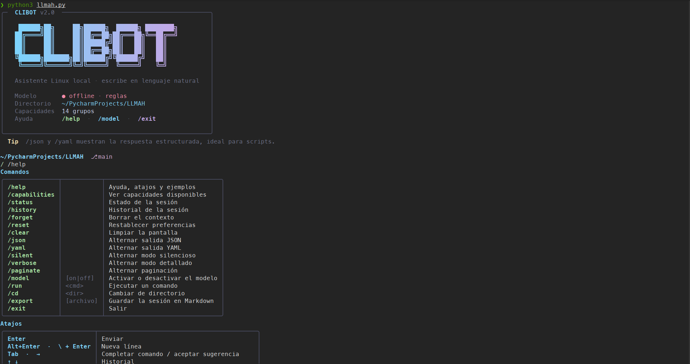

# CLIBOT (CLI Bot)

**CLIBOT** es un asistente de terminal **offline-first** para inspección, diagnóstico y administración local en sistemas Linux. 

Combina reglas locales deterministas de ejecución segura con la posibilidad de conectar modelos locales (como **Ollama**) para la interpretación de consultas avanzadas.


---

##  Requisitos Previos

- **Sistema Operativo:** Linux
- **Python:** 3.11 o superior
- **Git:** Para clonar el repositorio

---

##  Guía Paso a Paso: Descarga e Instalación

### Método Rápido (Recomendado)

Usa el script de instalación automatizada que configura todo automáticamente:

```bash
# 1. Clonar el repositorio
git clone https://github.com/nocturne-cybersecurity/Clibot.git
cd Clibot

# 2. Ejecutar el script de instalación
python3 instalacion.py
```

El script `instalacion.py` realizará automáticamente:
- ✓ Verificar versión de Python (requiere 3.11+)
- ✓ Crear entorno virtual (.venv)
- ✓ Instalar todas las dependencias
- ✓ Instalar CLIBOT en modo editable
- ✓ Preguntar si deseas instalar soporte de voz (Vosk)
- ✓ Configurar el comando global `clibot` en `~/.local/bin`
- ✓ Actualizar tu PATH si es necesario

Después de la instalación, recarga tu configuración de shell:
```bash
source ~/.bashrc  # o source ~/.zshrc
```

Luego simplemente ejecuta:
```bash
clibot
```

---

### Método Manual

Si prefieres configurar todo manualmente:

#### Paso 1: Clonar el Repositorio

```bash
git clone https://github.com/nocturne-cybersecurity/Clibot.git
cd Clibot
```

#### Paso 2: Crear el Entorno Virtual e Instalar Dependencias

```bash
# 1. Crear el entorno virtual (.venv)
python3 -m venv .venv

# 2. Activar el entorno virtual
source .venv/bin/activate

# 3. Instalar las dependencias
pip install -r requirements.txt
pip install -e .
```

#### Paso 3: Configurar el comando global `clibot` (Opcional)

Para ejecutar `clibot` desde cualquier ubicación:

```bash
mkdir -p ~/.local/bin
cat << EOF > ~/.local/bin/clibot
#!/usr/bin/env bash
"$(pwd)/.venv/bin/python" "$(pwd)/llmah.py" "\$@"
EOF
chmod +x ~/.local/bin/clibot

# Agregar al PATH si no está
echo 'export PATH="$HOME/.local/bin:$PATH"' >> ~/.bashrc
source ~/.bashrc
```

---

##  Uso de `clibot`

Una vez configurado, puedes lanzar el asistente desde cualquier directorio:

### 1. Modo Interactivo
Simplemente escribe:
```bash
clibot
```
Esto abrirá la consola interactiva con prompt `❯` e historial de comandos.

### 2. Modo Comando Directo
Puedes pasar una consulta directa usando el parámetro `--command`:

```bash
clibot --command "muestra la memoria RAM disponible"
clibot --command "lista los archivos en ."
clibot --command "muestra el estado de la red"
clibot --command "calcula raiz cuadrada de 144"
```

---

##  Ejemplos de Uso

### Sistema
```bash
clibot --command "¿qué hora es?"
clibot --command "muestra la información del sistema"
clibot --command "¿cuánta RAM tengo disponible?"
clibot --command "¿cuál es mi usuario actual?"
```

### Archivos y Directorios
```bash
clibot --command "lista los archivos de /tmp"
clibot --command "crea archivo notas.txt"
clibot --command "crea carpeta /tmp/proyecto"
clibot --command "elimina /tmp/archivo.txt"
clibot --command "mueve a.txt a /tmp"
clibot --command "modifica /tmp/config.yaml"
clibot --command "busca texto 'error' en /var/log"
```

### Gestión de Paquetes
```bash
clibot --command "apt install vim"
clibot --command "pip install requests"
clibot --command "npm install lodash"
```

### Red
```bash
clibot --command "muestra mis interfaces de red"
clibot --command "¿cuál es mi IP pública?"
clibot --command "muestra los puertos en escucha"
```

### Git
```bash
clibot --command "muestra el estado de git"
clibot --command "crea un repositorio git llamado demo"
clibot --command "clona https://github.com/usuario/proyecto.git"
clibot --command "git add README.md"
clibot --command "haz un commit con mensaje 'documenta el proyecto'"
clibot --command "git pull origin main"
clibot --command "git push origin main"
```
Pull, push, checkout, merge y rebase requieren confirmación; init, clone, add y commit se ejecutan según la ruta y los cambios que indiques. Para commit, primero prepara los archivos con `git add`; los errores de Git se muestran en vez de tratarse como éxito.

### Comandos Multi-línea
Para comandos largos, usa `\` al final de la línea:
```bash
~/PycharmProjects/CLIBOT ❯ crea archivo script.py \
... con contenido '#!/usr/bin/env python3\nprint("Hola mundo")'
```

### Salida Estructurada
Activa modo JSON o YAML para integración con scripts:
```bash
clibot
/json
clibot --command "lista los archivos de /tmp"
/yaml
clibot --command "muestra la memoria RAM"
```

---

##  Comandos Internos de la Terminal

Dentro del modo interactivo de `clibot`, dispones de comandos útiles:
- `/help` o `/capabilities`: Muestra las capacidades y operaciones disponibles.
- `/status`: Muestra el estado del sistema y del modelo LLM configurado.
- `/token` o `/token status`: Comprueba si hay token de GitHub sin revelarlo; `/token set` lo solicita oculto y lo guarda con permisos privados, y `/token clear` elimina el token guardado.
- `/models`: Muestra modelos instalados y abre el catálogo en línea de Ollama; escribe un número para descargar uno. `/models search <texto>` filtra el catálogo; `/models pull <modelo[:variante]>` descarga y selecciona, y `/models use <modelo>` cambia entre los instalados. El catálogo requiere Internet.
- `/micro on|off`: Activa o desactiva dictado de comandos en español con Vosk local. Mientras escucha, puedes hablar o escribir `/micro off`; también puedes decir «micro off» o pulsar Ctrl+C. El audio no se guarda ni se envía por Internet.
- `/mic list|use`: Lista o cambia el modelo de reconocimiento de voz (similar a `/models`).
- `/voice on|off|list|use`: Activa/desactiva respuesta de voz, lista perfiles disponibles o cambia la voz TTS. Por defecto usa una voz de mujer joven.
- `/keys list|set|clear <servicio>`: Gestiona API keys para OpenAI, GitHub, Stack Exchange, Anthropic, Google, etc.

**Configuración del micrófono:**
La primera vez que ejecutes CLIBOT, te preguntará si deseas instalar el modelo de voz. Si aceptas, se descargarán automáticamente:
- Vosk (librería de reconocimiento de voz)
- Modelo español pequeño (~50 MB)
- alsa-utils (en Linux, para capturar audio)

Si instalas el modelo de voz, `/micro on` se activará automáticamente en las siguientes ejecuciones. Puedes desactivarlo con `/micro off`.

Si prefieres instalarlo manualmente:
```bash
pip install -e '.[voice]'
sudo apt install alsa-utils
mkdir -p ~/.cache/clibot
cd ~/.cache/clibot
wget https://alphacephei.com/vosk/models/vosk-model-small-es-0.42.zip
unzip vosk-model-small-es-0.42.zip
rm vosk-model-small-es-0.42.zip
```

El modelo se guardará en `~/.cache/clibot/vosk-model-small-es-0.42/`. Opcionalmente, puedes configurar una ruta alternativa con `export CLIBOT_VOSK_MODEL=/ruta/a/tu/modelo`.

**Modelos de voz más avanzados:**

El modelo pequeño (`vosk-model-small-es-0.42`, ~50 MB) es básico y puede tener dificultades con:
- Palabras en inglés mezcladas con español
- Nombres de aplicaciones (Chrome, Wireshark, Nmap, etc.)
- Reconocimiento en entornos ruidosos

Para mejor reconocimiento, puedes descargar modelos más grandes:

**Opción 1: Modelo Vosk español grande (recomendado)**
```bash
cd ~/.cache/clibot
wget https://alphacephei.com/vosk/models/vosk-model-es-0.42.zip
unzip vosk-model-es-0.42.zip
rm vosk-model-es-0.42.zip
```
Este modelo (~1.8 GB) tiene mejor precisión en español, pero sigue siendo monolingüe.

**Opción 2: Usar el modelo grande en CLIBOT**
```bash
/mic use ~/.cache/clibot/vosk-model-es-0.42
/micro off
/micro on
```

**Nota sobre modelos multilingües:**
Para reconocimiento de español e inglés mezclados (incluyendo nombres de aplicaciones), se recomienda usar Whisper de OpenAI. Whisper es más avanzado pero requiere:
```bash
pip install openai-whisper
```
La integración con Whisper en CLIBOT requiere configuración adicional. Los modelos Whisper varían desde ~70 MB (base) hasta ~10 GB (large), con soporte nativo para múltiples idiomas y mejor reconocimiento de nombres técnicos.

**Configuración de respuesta de voz (TTS):**
Para que CLIBOT responda con voz, instala pyttsx3:
```bash
pip install -e '.[tts]'
```
Luego activa la respuesta de voz con `/voice on`.

**Perfiles de voz disponibles:**
- `default` - Mujer joven (voz predeterminada)
- `female_young` - Mujer joven
- `female_adult` - Mujer adulta
- `male_young` - Hombre joven
- `male_adult` - Hombre adulto

**Comandos para gestionar la voz:**
```bash
/voice on              # Activar respuesta de voz
/voice off             # Desactivar respuesta de voz
/voice list            # Ver perfiles disponibles
/voice use female_young  # Cambiar a perfil específico
/voice status          # Ver estado actual (voz, velocidad, volumen)
```

**Nota:** Las voces disponibles dependen de tu sistema operativo. pyttsx3 detecta automáticamente las voces instaladas en tu sistema y las mapea a los perfiles. En Linux, es posible que necesites instalar voces adicionales del sistema para más opciones.
- `/model on|off`: Activa o desactiva el LLM durante la sesión.
- Puedes pedir en lenguaje natural «cierra Chrome», «cierra Spotify» y otras aplicaciones conocidas; CLIBOT muestra qué operación ejecutará y pide confirmación porque podría perderse trabajo sin guardar.
- `/history`: Muestra el historial de la sesión actual.
- `/forget`: Limpia la memoria de la sesión actual.
- `/clear`: Limpia la pantalla de la terminal.
- `/json`: Activa/desactiva la salida en formato JSON.
- `/yaml`: Activa/desactiva la salida en formato YAML (requiere PyYAML).
- `/silent`: Activa/desactiva el modo silencioso (solo errores).
- `/reset`: Restablece todas las preferencias.
- `/exit`: Sale de la aplicación.

---

##  Uso Opcional con Modelo Local (Ollama)

CLIBOT funciona sin depender de un modelo remoto. Si **Ollama** está ejecutándose con un modelo instalado, lo detecta automáticamente para responder preguntas abiertas y entender peticiones que no coinciden con una regla. `/models` muestra los modelos locales y consulta el catálogo oficial de Ollama; en una terminal interactiva puedes buscar modelos y escoger una variante para descargarla. Para uso no interactivo están `/models search <texto>` y `/models pull <modelo[:variante]>`. La selección se guarda en `~/.config/clibot/llm.json` (permisos privados); también puedes configurar el modelo con variables de entorno:

En equipos modestos con CPU, `qwen2.5:1.5b` o `qwen2.5:0.5b` son candidatos más pequeños que Phi-3 mini por número de parámetros. Eso no garantiza que respondan más rápido ni con la misma calidad: depende de CPU, cuantización, memoria y longitud del prompt; no se incluye un benchmark de este equipo. Consulta las fichas oficiales de [Qwen2.5 1.5B](https://ollama.com/library/qwen2.5:1.5b) y [Qwen2.5 0.5B](https://ollama.com/library/qwen2.5:0.5b). La petición local de Ollama usa un timeout de socket de 10 segundos, que evita esperas indefinidas por falta de respuesta, pero no es una garantía de duración total. Descargar un modelo requiere Internet y no se hace automáticamente.

```bash
export CLIBOT_LLM_PROVIDER=ollama
export CLIBOT_LLM_MODEL='llama3.2' # Reemplaza por el nombre de tu modelo en 'ollama list'
clibot
```

### Uso con OpenAI u otros proveedores compatibles

```bash
export CLIBOT_LLM_PROVIDER=openai
export CLIBOT_LLM_MODEL=gpt-4o-mini
export LLM_API_KEY=your_api_key_here
clibot
```

### Integraciones con APIs externas

Las solicitudes para crear o explicar código usan el modelo activo; no se sustituyen por plantillas fijas ni disparan búsquedas web. Para buscar código existente, pide explícitamente que lo busque en GitHub o Stack Overflow; esos resultados conservan atribución y enlaces. Para investigar otros temas en línea, pídelo expresamente (por ejemplo, «busca en la web…»). La búsqueda de código de GitHub requiere un token personal:

```bash
# GitHub (configúralo de forma oculta desde /token set o usa la variable de entorno)
export GITHUB_TOKEN=your_github_token

# Stack Exchange (opcional, para mayor límite de tasa)
export STACK_EXCHANGE_KEY=your_stack_exchange_key
```

Sin estas variables, las integraciones funcionan con límites estándar para acceso público.

---

##  Pruebas y Desarrollo

Para verificar que todos los módulos y pruebas del sistema funcionan correctamente:

```bash
source .venv/bin/activate
pytest
```

---

## 🛡️ Licencia

Este proyecto está bajo la Licencia MIT.
